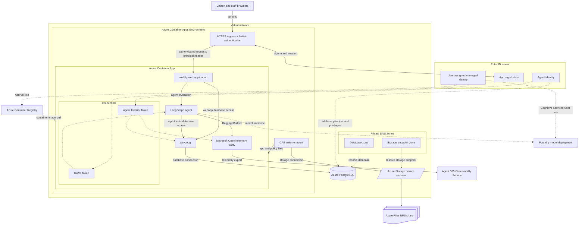
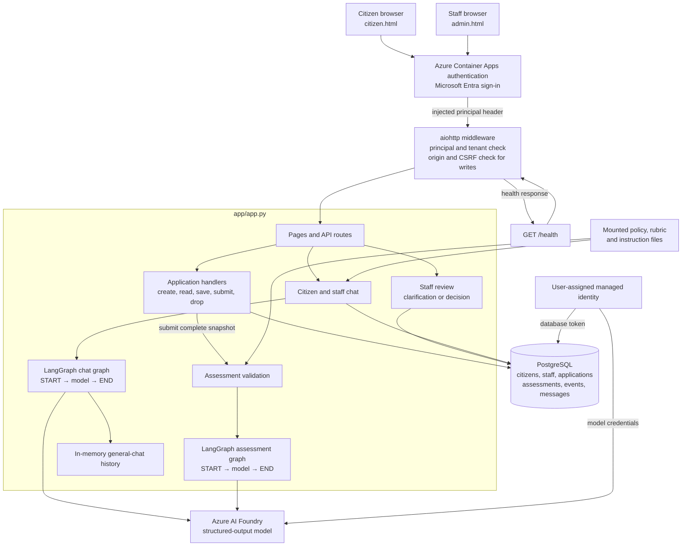
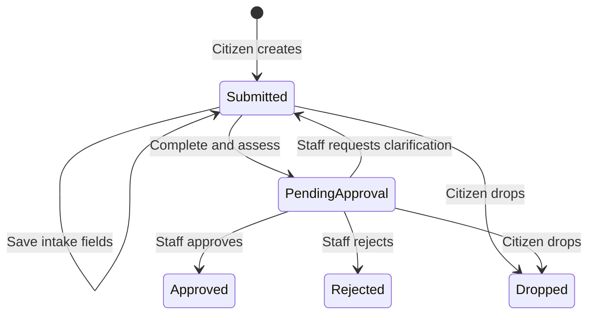

## 1. Azure infrastructure architecture

This diagram shows the **deployment described by the repository**, not a verified live Azure environment. The repository provides application code, a Dockerfile and deployment instructions; it does not provision the Azure resources or permissions itself.

### 1.2. Connections and responsibilities

| Connection | What the repository specifies |
|---|---|
| **Browser → Container Apps** | HTTPS ingress exposes the app, which listens on port `8080`. Container Apps built-in authentication uses Entra ID; the app reads the platform-injected principal and checks the configured tenant. Writes also require an origin check and CSRF token. `README.md:30–31`, `app/app.py:93` |
| **Container Apps → ACR** | The platform pulls the runtime image using the attached managed identity. The README calls for `AcrPull`; the specification notes that the appropriate permission depends on the registry authorization mode. `README.md:21–24`, `spec.md:142` |
| **Container Apps → Azure Files** | The environment mounts an NFS share at `/app` through a private endpoint, with private DNS and TCP `2049` connectivity. The share contains the executable app, HTML, policy, rubric and model instructions. This mount uses network/storage configuration—not an application managed-identity token. `README.md:29–30` |
| **App → PostgreSQL** | For each new connection, the app requests a PostgreSQL Entra access token using the user-assigned managed identity and connects with certificate and hostname verification. PostgreSQL stores applications, identities, assessments, events and case-specific chat. The identity needs a database principal and sufficient DDL/data privileges. `app/app.py:32`, `app/app.py:134`, `README.md:21–25` |
| **App → Foundry** | The app initializes the configured Foundry deployment with the same managed-identity credential. LangGraph uses the model for chat and advisory assessments; the repository calls for an inference role on the endpoint. `app/app.py:504–515`, `README.md:17–24` |

The repository requires network reachability to PostgreSQL and Foundry, but **does not establish whether those services use private endpoints or public endpoints**. Only the Azure Files private endpoint is explicitly described.

### 1.3. Identity and access management

#### 1.3.1. Azure Container Apps Entra ID Authorization

Azure Container Apps provides built-in authentication and authorization features (sometimes referred to as "Easy Auth"), to secure external ingress-enabled container app with minimal or no code. (https://learn.microsoft.com/en-us/azure/container-apps/authentication)

Setup: https://learn.microsoft.com/en-us/azure/container-apps/authentication-entra

#### 1.3.2. [planned] change to Entra agent identity for postgres access

### 1.4. [planned] security services to turn on

Likely no/minimal change required for architecture and code, some maybe already part of the services planned or just turn on:
- Code security
    - Source code control commit to GitHub for GHAS: CodeQL, Dependabot, secrets scanning
    - Connect GitHub repo to MDASH for agentics scans
- Defender for Cloud
    - Defender CSPM
    - Defender for SQL
    - Defender for DevOps (connect GitHub)
    - Defender for Containers
- Agent 365
    - Agent identity and governance
    - Agent registry
    - Observability with Microsoft OpenTelemetry
    - Security for AI - Defender real-time threat protection

### 1.5. Operational and security boundaries

- **Demo access only:** Any authenticated user in the configured tenant can enter the staff portal, see all applications and make decisions; there is no staff-role check. Use synthetic data and restrict participants. `README.md:1–3`
- **Authentication trust:** The app trusts the platform-provided principal header. Deployment must prevent requests from bypassing platform authentication or supplying a spoofed header. `README.md:31`
- **NFS protection:** The deployment guide notes that Container Apps NFS does not support encryption in transit. Restrict its network access and protect the share: it contains executable code and model instructions. `README.md:29`
- **Image versus mount:** The Dockerfile provides Python and dependencies but does **not** copy the application into the runtime image; it runs the mounted `app.py`. Restart the revision after changing mounted code or materials. `Dockerfile:38–55`, `README.md:30–32`

## 2. Application architecture

### 2.1. Request and application flow

1. **Startup:** `startup()` loads configuration and the policy, rubric and instruction files, creates a managed-identity credential and two LangGraph graphs, then creates the PostgreSQL tables if needed. Both graphs consist of one model node; only chat has an in-memory checkpointer. See `app/app.py:257` and `app/app.py:504`.

2. **Authentication and access:** The app relies on the platform-injected `X-MS-CLIENT-PRINCIPAL` header, verifies its tenant ID, and checks the origin and CSRF token on writes. `GET` and `HEAD /health` bypass these checks. Citizen case queries are scoped to their owner; **staff access has no role check**—any authenticated user in the configured tenant can access all cases and make decisions. See `app/app.py:93`, `app/app.py:157` and `README.md:3`.

3. **Citizen intake:** A citizen creates an application in `submitted` status, saves validated intake fields and submits it for assessment. “Submitted” is also the editable, potentially incomplete state—not necessarily an assessed application. See `app/app.py:346` and `app/app.py:377`.

4. **Assessment:** Submission takes a complete application snapshot and sends it with the policy and rubric to the structured-output model. The app validates the assessment, including rubric references and checks for certain decision or eligibility language. It then locks and rechecks the application’s status and revision before saving the assessment, policy/rubric SHA-256 hashes and event, and moving the case to `pending approval`. Failures leave the information saved and return an error. See `app/app.py:281` and `app/app.py:393`.

5. **Human review:** Staff can request clarification, approve or reject only when a current assessment matches the application revision. A written reason is required. Clarification returns the case to `submitted`, invalidates the current assessment and increments the revision. The model’s assessment is advisory; the staff action records the decision. See `app/app.py:438`.

6. **Chat:** Both portals use the chat graph with portal-specific instructions. Case-specific chat loads authorized case context and the last 20 stored messages; its messages are persisted in PostgreSQL. General chat instead uses the in-memory checkpointer. Citizen field suggestions are returned for review and must be explicitly saved; staff chat does not perform case actions. See `app/app.py:460`.

### 2.3. Case lifecycle

**Deployment boundary:** The application trusts the platform-provided identity header rather than independently verifying it, so ingress must prevent clients from bypassing platform authentication or spoofing that header. The repository describes this as a synthetic-data demo, not a production service (`README.md:29`).